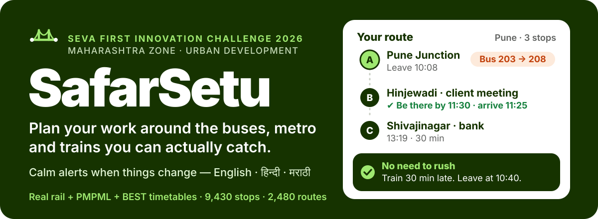
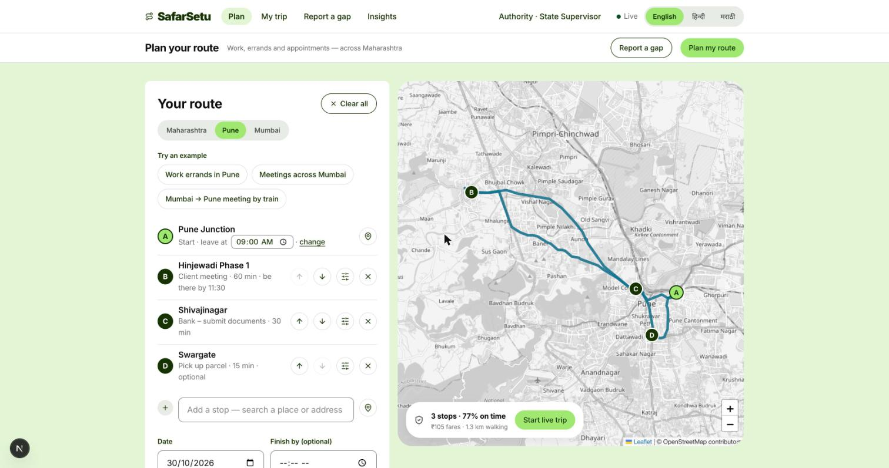
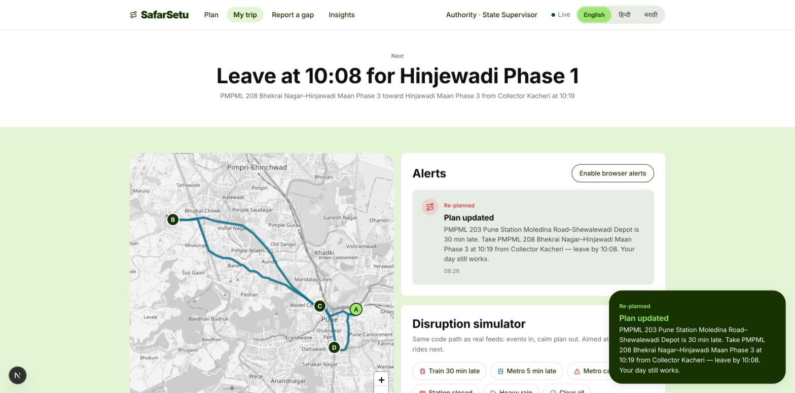
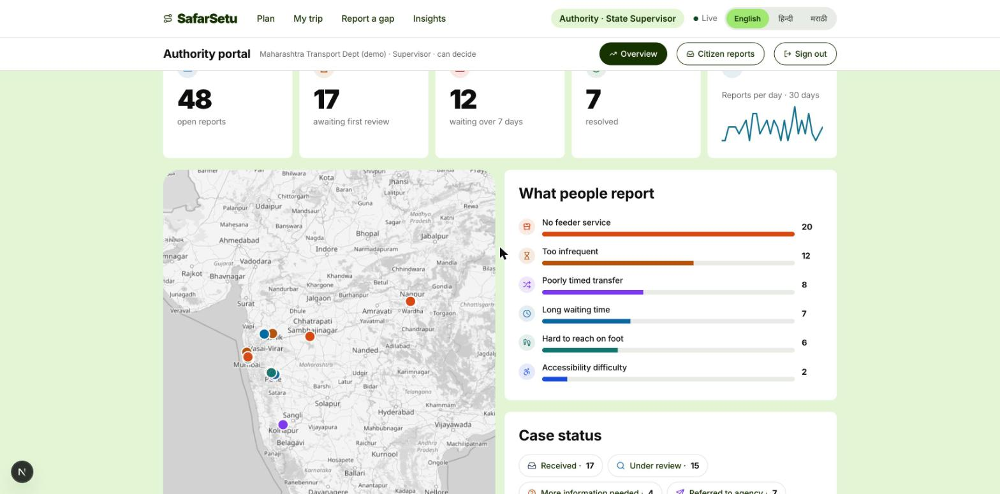
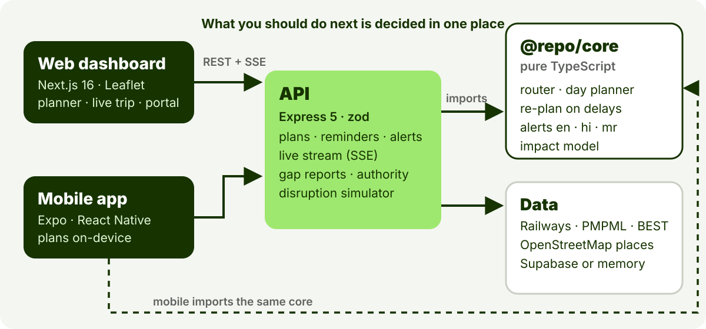

<p align="center">
  
</p>

<p align="center">
  <a href="docs/README.md"><b>Docs</b></a> ·
  <a href="submission/SafarSetu-Seva-First-Pitch.pdf"><b>Pitch deck (PDF)</b></a> ·
  <a href="DATA_SOURCES.md">Data sources</a> ·
  <a href="docs/14-pilot-plan.md">Pilot plan</a>
</p>

**SafarSetu** helps people with a day of work — a client meeting, the bank before it closes, a parcel to collect — move through Maharashtra on the public transport they can actually catch. Add stops like you would in a maps app, say when you must be there, and it lines up the buses, metro and trains, tells you **when to leave and what to board**, and keeps the plan right when something is late or cancelled.


<table>
  <tr>
    <td width="33%"></td>
    <td width="33%"></td>
    <td width="33%"></td>
  </tr>
  <tr>
    <td><sub><b>Plan.</b> Stops in your order, <i>be there by 11:30</i>, a must-do flag per stop.</sub></td>
    <td><sub><b>Stay on track.</b> A 30-minute delay → “take this bus instead, leave by 10:08”.</sub></td>
    <td><sub><b>Close the loop.</b> Citizens report unconnected areas; authorities see ranked gaps.</sub></td>
  </tr>
</table>

### What it does

- **Plans a working day, not just a trip.** Ordered multi-stop routes with a task, time needed and an optional *be there by* for each stop. Appointments get a safety buffer, and you leave the previous stop *later* rather than wait at the next one. A stop you mark *must happen* is never dropped — if it can't work, the plan says exactly why.
- **Alerts that say what to do.** “No need to rush — your train is 30 min late. Leave at 10:40.” The tone follows the slack you really have; if a delay would make you late for a meeting it says so and suggests the alternative. English, हिन्दी and मराठी.
- **Real timetables where they exist.** Indian Railways trains, PMPML (Pune) and BEST (Mumbai) buses, merged into one network of 9,430 stops and 2,480 routes.
- **Chooses your transport.** Switch local trains, express trains, metro, buses or a cab fallback on and off.
- **Works on the phone too.** The Expo app has the same stop editor — search, reorder, task, time needed, *be there by* — and plans offline with the shared engine.
- **Includes more people.** A *Gentle* pace for seniors and limited mobility, a warning for long walks after dark, and a read-only link to share your live trip.
- **Built to be piloted.** One-tap, anonymous “was this alert useful?” and “how did the day go?” feedback; a field-interview kit for baseline evidence; audit-logged authority actions, login throttling, and automatic 12-month deletion of citizen reports. A real-time feed adapter (GTFS-Realtime) is written and tested, waiting for an agency to share a feed.
- **Helps authorities see where journeys break.** Citizens report two areas that should be connected; officials see grouped, ranked gaps with every scoring factor visible and adjustable. Roles and jurisdictions are enforced.


<p align="center">
  
</p>

Everything that decides *what you should do* lives in [`packages/core`](packages/core) — pure TypeScript, no DOM and no Node APIs — so the API, the web dashboard and the phone app run identical logic.

1. **Route** — a round-based earliest-arrival search over timetables, with walking transfers and a cab fallback.
2. **Plan** — orders your stops, checks opening hours and deadlines, and leaves later instead of waiting (`planDay`).
3. **Watch** — disruptions are events laid over immutable timetables. `assessPlan` re-times your plan, or re-plans the rest of the day, and explains the change.
4. **Tell** — a deterministic message composer picks the tone from your slack and fills in times and names in your language. No model decides a fact.


The demo is honest about its data. Every API response carries a data-quality label.

| | Status | Source |
|---|---|---|
| Railway timetable (959 trains, 549 stations) | **Real** — every train assumed to run daily | Datameet / Indian Railways |
| Pune buses (623 patterns) · Mumbai buses (884 patterns) | **Real timetables**, stop-to-stop ride times *modelled* by the feed | community GTFS, MIT-0 |
| Places (71 across 13 areas) | Real names and coordinates, **assumed** hours | OpenStreetMap |
| Metros, Mumbai locals, Pune–Lonavala local | **Synthetic** — shape follows the real lines, times invented | this repo |
| Live delays | **Simulated** (disruption simulator); no live agency feed yet | — |
| Citizen reports, authority accounts | **Demo data**, labelled in the portal | this repo |
| Impact numbers | **Estimates** from a transparent model, nothing measured | [`/impact`](apps/web/app/impact/page.tsx) |

Full list with licences and limits: [`DATA_SOURCES.md`](DATA_SOURCES.md).


```sh
pnpm install
pnpm --filter api dev     # http://localhost:4000 — no API keys, in-memory store
pnpm --filter web dev     # http://localhost:3000
pnpm test                 # engine + API tests
```

Open the planner, add a few stops (or try an example), press **Plan my route**, then **Start live trip → Start demo day** and fire a delay from the disruption simulator. The authority portal is at `/authority` — demo accounts are offered on its sign-in page. Optional: `apps/api/.env.example` (Supabase, secrets), `docs/07-database.md` (local Postgres).

| Path | What |
|---|---|
| `packages/core` | Planning engine, alerts (en/hi/mr), impact model, data packs, typed client |
| `apps/api` | Express 5 API, live stream, scheduler, authority and report endpoints, Supabase migrations |
| `apps/web` | Next.js 16 dashboard — planner, live trip, report a gap, authority portal, field kit |
| `apps/app` | Expo phone app — same stop editor and planner, running the core on-device |
| `submission/` | Seva First pitch deck, built from the official template |


SafarSetu is built for the **[Seva First Innovation Challenge 2026, Maharashtra Zone](https://sevainnovationchallenge.in)** (sector: Urban development), whose guide asks for four things. Where we stand:

| The judges look for | Where it is | Status |
|---|---|---|
| A real problem **with evidence** | Sourced facts in [`docs/research`](docs/research/seva-research.md); interview kit in [`/field`](docs/15-field-research-kit.md) | Secondary evidence ✔ · **primary interviews still to do** |
| A **working demo** | This repo; screenshots above | ✔ runs locally · public URL pending |
| Fits **money already spent** | Complements ITMS and grievance systems — [argument and sources](docs/14-pilot-plan.md) | ✔ argued, no agency agreement yet |
| A deliverable **pilot plan** | [`docs/14-pilot-plan.md`](docs/14-pilot-plan.md): 4 stages, a number each, named roles, finance | ✔ planned · nothing piloted |

#### Known limits

No pilot has been run, so no time-saved or cost-saved result exists. Live agency feeds are not connected (none is publicly available). No external security audit has been done. Marathi and Hindi text needs native-speaker review before use. On an 8-core laptop the API plans about 55 per second with 3 worker processes (p95 ≈ 0.4 s at 10 concurrent users); beyond one machine, scale-out is documented, not built. Supabase storage is written and its schema validated, but the adapter has not been run against a live database.

<sub>Map © OpenStreetMap contributors · Timetables: Datameet / Indian Railways, community GTFS for PMPML and BEST (MIT-0) · Design language: <a href="docs/DESIGN.md">docs/DESIGN.md</a></sub>
